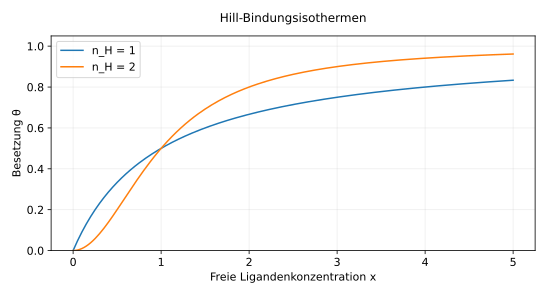

# M30-L1 – Bindungsgleichgewichte und Kooperativität {#L1}

**Kursbereich:** M30 – Biophysikalische und zeitaufgelöste Chemie

**Niveau:** Master – Wahlprofil (hochschulabhängig)

**Vorwissen:** [M17-L5](M17-L5.md).

**Lernziel:** Bindungsisothermen und Kooperativität quantitativ interpretieren.

## Fachliche Grundlagen {#S1}

Für $P+L\rightleftharpoons PL$ gilt im ideal verdünnten Gleichgewicht $K_D=[P][L]/[PL]$. Die Besetzung ist $\theta=[L]/(K_D+[L])$, wobei [L] freie Ligandenkonzentration bedeutet. Mehrere Bindungsstellen können gekoppelt sein; positive Kooperativität führt häufig zu einer steileren Übergangskurve.

## Methoden und Modellannahmen {#S2}

Die Hill-Form $\theta=x^{n_H}/(1+x^{n_H})$ mit $x=[L]/K_{1/2}$ beschreibt eine normierte Kurve. $n_H$ ist ein empirischer Steilheitsparameter, nicht grundsätzlich die Anzahl der Bindungsstellen. Bei Ligandenverarmung ist die Massenbilanz mit zu lösen.

## Modellrechnung {#S3}

Bei x=2 erhält man für $n_H=1$ eine Besetzung 2/3 und für $n_H=2$ eine Besetzung 4/5. Bei x=0,5 sind es 1/3 beziehungsweise 1/5. Beide Kurven besitzen bei x=1 eine Besetzung von 0,5.

*Hill-Bindungsisothermen – fiktive Modelldaten.*

## Grenzen und typische Fehler {#S4}

Hill-Parameter allein beweisen keinen mikroskopischen Mechanismus. Konzentrationsangaben müssen zwischen freiem und gesamtem Liganden unterscheiden.

## Selbstkontrolle {#S5}

### Aufgaben

1. Welche Besetzung gilt bei x=1?
2. Wie groß ist sie bei x=2 und n_H=2?
3. Beweist n_H=2 zwei Bindungsstellen?

::: {.lc-solutions data-lc-section="S5"}
1. 0,5.
2. 0,8.
3. Nein.
:::

## Quellen (extern) {#S6}

### Nachweise

- [EMBL Hamburg – Sample Preparation and Characterisation Facility](https://www.embl.org/groups/sample-preparation-characterisation/) · Biophysikalische Messmethoden · M30-L1 – Bindungsgleichgewichte und Kooperativität · Zuletzt recherchiert: 2026-11-25 (indexed web result; full section review pending).
- [Cooperative Binding – review](https://pmc.ncbi.nlm.nih.gov/articles/PMC3699289/) · Hill-Modell und Kooperativität · M30-L1 – Bindungsgleichgewichte und Kooperativität · Zuletzt recherchiert: 2026-11-25 (indexed web result; full section review pending).
