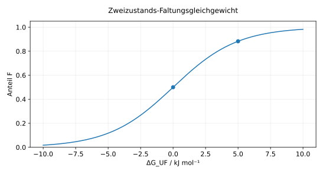

# M30-L2 – Konformation und Faltung {#L2}

**Kursbereich:** M30 – Biophysikalische und zeitaufgelöste Chemie

**Niveau:** Master – Wahlprofil (hochschulabhängig)

**Vorwissen:** [M14-L4](M14-L4.md).

**Lernziel:** Konformationspopulationen und Faltungsstabilität unterscheiden.

## Fachliche Grundlagen {#S1}

Biomoleküle bilden ein Ensemble von Konformationen. Faltung entsteht aus vielen Beiträgen, darunter Wasserstoffbrücken, hydrophobe Effekte, elektrostatische Wechselwirkungen und Konformationsentropie. Stabilität beschreibt eine freie Energiedifferenz, nicht die Höhe der kinetischen Barriere.

## Methoden und Modellannahmen {#S2}

Im idealen Zweizustandsmodell F ⇌ U sei $\Delta G_{UF}=G_U-G_F$. Dann gilt $K_U=[U]/[F]=\exp(-\Delta G_{UF}/RT)$ und $p_F=1/(1+K_U)$. Zwischenzustände, Aggregation und irreversible Änderungen verletzen die Modellannahmen.

## Modellrechnung {#S3}

Bei 298 K und fiktivem $\Delta G_{UF}=5$ kJ/mol ist $K_U\approx0{,}133$ und $p_F\approx0{,}883$. Bei $\Delta G_{UF}=0$ sind beide Populationen gleich groß.

*Zweizustands-Faltungsgleichgewicht – fiktive Modelldaten.*

## Grenzen und typische Fehler {#S4}

Eine Messkurve kann mehrere Konformationen mitteln; die Zweizustandsannahme ist mit unabhängigen Daten zu prüfen. Thermodynamische Populationen sagen nicht, wie schnell der Übergang erfolgt.

## Selbstkontrolle {#S5}

### Aufgaben

1. Wie groß ist p_F bei ΔG=0?
2. Welche Population dominiert bei positivem ΔG_UF?
3. Ist Stabilität gleich Faltungsgeschwindigkeit?

::: {.lc-solutions data-lc-section="S5"}
1. 0,5.
2. F.
3. Nein.
:::

## Quellen (extern) {#S6}

### Nachweise

- [EMBL Hamburg – Sample Preparation and Characterisation Facility](https://www.embl.org/groups/sample-preparation-characterisation/) · Biophysikalische Messmethoden · M30-L2 – Konformation und Faltung · Zuletzt recherchiert: 2026-11-25 (indexed web result; full section review pending).
- [Fundamentals to function: Quantitative and scalable approaches for measuring protein stability](https://pmc.ncbi.nlm.nih.gov/articles/PMC9337709/) · Zweizustandsmodell und Proteinstabilität · M30-L2 – Konformation und Faltung · Zuletzt recherchiert: 2026-11-25 (indexed web result; full section review pending).
