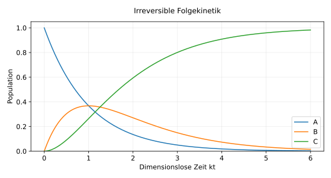

# M30-L4 – Kinetische Mehrzustandsmodelle {#L4}

**Kursbereich:** M30 – Biophysikalische und zeitaufgelöste Chemie

**Niveau:** Master – Wahlprofil (hochschulabhängig)

**Vorwissen:** [M30-L3](M30-L3.md).

**Lernziel:** Mehrzustandskinetik als Populationsbilanz verstehen.

## Fachliche Grundlagen {#S1}

Bei einem irreversiblen Modell A → B → C mit konstanten Raten gilt $dA/dt=-k_1 A$, $dB/dt=k_1 A-k_2 B$ und $dC/dt=k_2 B$. Bei normierter Anfangspopulation A=1 und B=C=0 bleibt die Summe A+B+C=1. Das Zwischenprodukt steigt zunächst an und fällt später ab.

## Methoden und Modellannahmen {#S2}

Für den Spezialfall $k_1=k_2=k$ folgt $A=e^{-kt}$, $B=kt e^{-kt}$ und $C=1-(1+kt)e^{-kt}$. Das Maximum von B liegt bei kt=1, wie die Ableitung $dB/d(kt)=(1-kt)e^{-kt}$ zeigt. Beobachtete Signale sind häufig gewichtete Summen der Populationen.

## Modellrechnung {#S3}

Bei dimensionsloser Zeit kt=1 ergeben sich A=B=0,3679 und C=0,2642. Bei kt=2 ist B=0,2707. Dies ist ein abstraktes Populationsmodell ohne konkrete chemische Umsetzung.

*Irreversible Folgekinetik – fiktive Modelldaten.*

## Grenzen und typische Fehler {#S4}

Ein mehr-exponentielles Signal kann aus verschiedenen Mechanismen entstehen. Identifizierbarkeit verlangt unabhängige Beobachtungen, ausreichende Zeitauflösung und Fehleranalyse.

## Selbstkontrolle {#S5}

### Aufgaben

1. Wann ist B maximal?
2. Welche Summe bleibt konstant?
3. Wie groß ist C bei kt=1?

::: {.lc-solutions data-lc-section="S5"}
1. Bei kt=1.
2. A+B+C=1.
3. 0,2642.
:::

## Quellen (extern) {#S6}

### Nachweise

- [EMBL Hamburg – Sample Preparation and Characterisation Facility](https://www.embl.org/groups/sample-preparation-characterisation/) · Biophysikalische Messmethoden · M30-L4 – Kinetische Mehrzustandsmodelle · Zuletzt recherchiert: 2026-11-25 (indexed web result; full section review pending).
- [EMBL Hamburg – Services and Resources](https://www.embl.org/groups/sample-preparation-characterisation/services-and-resources/) · Zeitaufgelöste Messverfahren · M30-L4 – Kinetische Mehrzustandsmodelle · Zuletzt recherchiert: 2026-11-25 (indexed web result; full section review pending).
