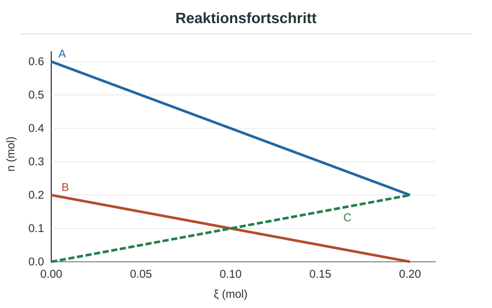

# M4-L2 – Reaktionsgleichungen und Ausbeuten {#L2}

**Kursbereich:** M4 – Allgemeine Chemie und Stöchiometrie

**Niveau:** Bachelor

**Vorwissen:** [M4-L1](M4-L1.md).

**Lernziel:** Reaktionsgleichungen bilanzieren und theoretischen Umsatz, limitierenden Stoff sowie Ausbeute unterscheiden.

## Erhaltung und Reaktionsfortschritt {#S1}
Eine ausgeglichene Reaktionsgleichung erhält die Zahl jeder Atomsorte und die Gesamtladung. Die stöchiometrischen Zahlen $\nu_i$ sind negativ für Edukte und positiv für Produkte. Bei einer einzigen unabhängigen Reaktion gilt $n_i=n_{i,0}+\nu_i\xi$, wobei $\xi$ der Reaktionsfortschritt in mol ist. Die Gleichung beschreibt eine Stoffbilanz, nicht notwendigerweise den molekularen Mechanismus.

*Modell 2A + B → C; B limitiert bei ξ = 0,20 mol.*

## Limitierung und Ausbeute {#S2}
Bei vollständigem Ablauf in Vorwärtsrichtung ist $\xi_{\max}=\min_{\nu_i<0}(n_{i,0}/|\nu_i|)$. Der kleinste Quotient bestimmt das limitierende Edukt. Die theoretische Produktmenge ist dann $\nu_P\xi_{\max}$, sofern anfangs kein Produkt vorliegt. Die prozentuale Ausbeute ist das Verhältnis der tatsächlich erhaltenen zur theoretischen Produktmenge mal 100. Umsatz, Selektivität und isolierte Ausbeute sind nicht identisch.
## Rechenbeispiel {#S3}
Für die rein abstrakte Modellreaktion $2A+B\rightarrow C$ liegen 0,60 mol A und 0,20 mol B vor. Die Quotienten sind 0,30 und 0,20 mol; B limitiert. Theoretisch entstehen 0,20 mol C und 0,20 mol A bleiben übrig. Werden 0,15 mol reines C bilanziert, beträgt die Ausbeute 75 %. Die abstrakten Stoffe stehen für eine vereinfachte, element- und ladungserhaltende Gesamtreaktion.

## Grenzen und typische Fehler {#S4}

Koeffizienten sind Stoffmengenverhältnisse, keine Massenverhältnisse. Reine Produktmenge und Rohproduktmasse unterscheiden.

## Selbstkontrolle {#S5}

### Aufgaben

1. Bilanziere die formale Gleichung Mg + O₂ → MgO.
2. Bei $2A+B\rightarrow C$ sind 0,10 mol A und 0,20 mol B gegeben. Wie viel C maximal?
3. Aus 0,050 mol theoretischem Produkt werden 0,040 mol isoliert. Ausbeute?

::: {.lc-solutions data-lc-section="S5"}
1. 2 Mg + O₂ → 2 MgO.
2. 0,050 mol; A limitiert.
3. 80 %.
:::

**Weiterlesen:** [M4-L3](M4-L3.md).

## Quellen (extern) {#S6}

### Nachweise

- [OpenStax – Chemistry 2e, 4.3 Reaction Stoichiometry](https://openstax.org/books/chemistry-2e/pages/4-3-reaction-stoichiometry) · Stoffbilanz · Fachlicher Bezug zur Lektion: M4-L2 – Reaktionsgleichungen und Ausbeuten · Zuletzt abgerufen: 2026-11-25
- [OpenStax – Chemistry 2e, 4.4 Reaction Yields](https://openstax.org/books/chemistry-2e/pages/4-4-reaction-yields) · Limitierung und Ausbeute · Fachlicher Bezug zur Lektion: M4-L2 – Reaktionsgleichungen und Ausbeuten · Zuletzt abgerufen: 2026-11-25
