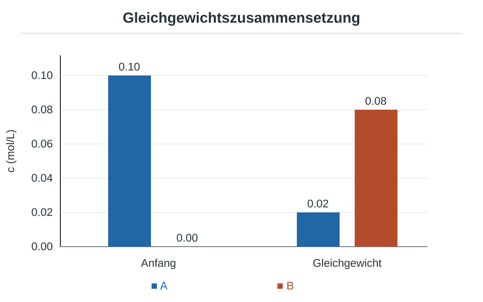

# M4-L5 – Gleichgewicht als chemisches Prinzip {#L5}

**Kursbereich:** M4 – Allgemeine Chemie und Stöchiometrie

**Niveau:** Bachelor

**Vorwissen:** [M4-L4](M4-L4.md).

**Lernziel:** Reaktionsquotienten und Gleichgewichtskonstanten berechnen und thermodynamische Richtung von Geschwindigkeit trennen.

## Dynamisches Gleichgewicht {#S1}
In einem geschlossenen, unter konstanten Bedingungen relaxierenden System bedeutet chemisches Gleichgewicht, dass sich die makroskopische Zusammensetzung nicht mehr ändert. Mikroskopische Hin- und Rückprozesse laufen weiter. Für eine Reaktion mit stöchiometrischen Zahlen $\nu_i$ lautet der dimensionslose Quotient $Q=\prod_i a_i^{\nu_i}$. Im Gleichgewicht gilt $Q=K(T)$. Reine Feststoffe und reine Flüssigkeiten haben in ihrer Standardzustandsnäherung Aktivität eins.

*Ideale Modellisomerisierung mit K = 4; Gesamtstoffmengenkonzentration bleibt 0,10 mol/L.*

## Richtung und Störung {#S2}
Für feste Temperatur gilt $\Delta_rG=RT\ln(Q/K)$. Bei $Q<K$ ist die Vorwärtsreaktion thermodynamisch begünstigt, bei $Q>K$ die Rückrichtung. Ein Katalysator beeinflusst die Relaxationszeit, nicht K. Änderungen der Zusammensetzung oder des Drucks verändern Q; Temperaturänderungen können K verändern. Das Prinzip von Le Chatelier ist eine qualitative Merkhilfe und ersetzt keine Bilanz.
## Rechenbeispiel {#S3}
Für eine ideale Modellisomerisierung $A\rightleftharpoons B$ gilt bei fester Temperatur $K=4$. Anfangs liegen 0,10 mol/L A und kein B vor. Bei konstantem Volumen folgt $4=x/(0{,}10-x)$, also $x=0{,}080$ mol/L. Im Gleichgewicht bleiben 0,020 mol/L A. Der Anfangszustand hat $Q=0$; die logarithmische Beziehung ist dort als Grenzwert zu verstehen. Die Bilanz legt keine Zeit bis zum Gleichgewicht fest.

## Grenzen und typische Fehler {#S4}

K und Q müssen dieselbe Reaktionsgleichung und Standardzustände verwenden. Gleichgewicht ist kein Stillstand.

## Selbstkontrolle {#S5}

### Aufgaben

1. Bei $K=4$ und $Q=8$: welche Richtung ist begünstigt?
2. Welche Konzentrationen ergeben sich bei gleichem Startwert und $K=1$?
3. Ändert ein Katalysator diese Gleichgewichtskonzentrationen?

::: {.lc-solutions data-lc-section="S5"}
1. Rückrichtung.
2. Je 0,050 mol/L.
3. Nein, sofern keine weiteren Prozesse oder Zustandsänderungen auftreten.
:::

**Weiterlesen:** [M5-L1](M5-L1.md).

## Quellen (extern) {#S6}

### Nachweise

- [OpenStax – Chemistry 2e, 13.2 Equilibrium Constants](https://openstax.org/books/chemistry-2e/pages/13-2-equilibrium-constants) · Reaktionsquotient und Gleichgewicht · Fachlicher Bezug zur Lektion: M4-L5 – Gleichgewicht als chemisches Prinzip · Zuletzt abgerufen: 2026-11-25
- [OpenStax – Chemistry 2e, 13.4 Equilibrium Calculations](https://openstax.org/books/chemistry-2e/pages/13-4-equilibrium-calculations) · Gleichgewichtsbilanz · Fachlicher Bezug zur Lektion: M4-L5 – Gleichgewicht als chemisches Prinzip · Zuletzt abgerufen: 2026-11-25
