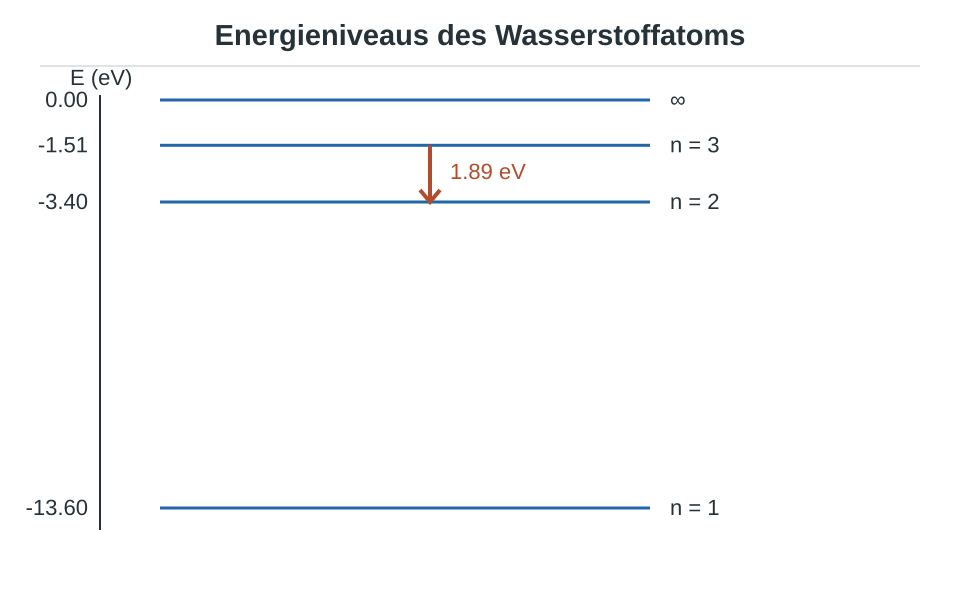

# M5-L1 – Atommodelle und Orbitale {#L1}

**Kursbereich:** M5 – Atomstruktur und chemische Bindung

**Niveau:** Bachelor

**Vorwissen:** [M4-L5](M4-L5.md).

**Lernziel:** Atommodelle einordnen und Orbitale als quantenmechanische Zustände statt klassischer Bahnen interpretieren.

## Vom Kernmodell zur Wellenfunktion {#S1}
Streuexperimente stützen das Modell eines kleinen positiv geladenen Kerns. Das Bohr-Modell erklärt ausgewählte Energien des Wasserstoffatoms, postuliert jedoch Bahnen, die keine allgemeine Beschreibung von Elektronen liefern. In der Quantenmechanik beschreibt $\psi$ einen Zustand; $|\psi|^2$ ist für einen normierten Einteilchenzustand die Wahrscheinlichkeitsdichte. Ein Orbital ist eine räumliche Einteilchen-Wellenfunktion, keine Oberfläche, auf der sich ein Elektron bewegt. Isodichte-Darstellungen zeigen nur einen gewählten Ausschnitt dieser Dichte.

*Energieachse maßstäblich; Modellübergang 3 → 2 emittiert ein Photon von etwa 1,89 eV.*

## Quantenzahlen und Besetzung {#S2}
Für wasserstoffartige Orbitale gelten $n=1,2,\ldots$, $l=0,\ldots,n-1$, $m_l=-l,\ldots,l$. Die Buchstaben s, p, d und f bezeichnen $l=0,1,2,3$. Der Spin eines Elektrons besitzt zwei mögliche Projektionen. Das Pauli-Prinzip beschränkt ein räumliches Orbital auf höchstens zwei Elektronen mit entgegengesetzten Spinprojektionen. Bei entarteten Orbitalen begünstigt die Hund-Regel zunächst ungepaarte Besetzung mit parallelen Spins. Mehrteilchenzustände verlangen Näherungen; Besetzungsregeln haben Ausnahmen.
## Rechenbeispiel {#S3}
Im Wasserstoffmodell ist $E_n\approx-13{,}6\,\mathrm{eV}/n^2$. Beim Übergang von n = 3 nach n = 2 wird ein Photon mit etwa $13{,}6(1/4-1/9)=1{,}89$ eV emittiert. Mit $hc\approx1240$ eV nm ergibt sich $\lambda\approx656$ nm. Feinstruktur und weitere Korrekturen bleiben unberücksichtigt.

## Grenzen und typische Fehler {#S4}

Ein Orbital ist keine klassische Bahn. Bohr-Energien sind auf das wasserstoffartige Modell beschränkt.

## Selbstkontrolle {#S5}

### Aufgaben

1. Welche l-Werte sind für n = 3 möglich?
2. Wie viele räumliche p-Orbitale hat eine p-Unterschale?
3. Wie lautet die Grundzustandskonfiguration des neutralen Kohlenstoffatoms?

::: {.lc-solutions data-lc-section="S5"}
1. 0, 1 und 2.
2. Drei; maximal sechs Elektronen.
3. 1s² 2s² 2p²; zwei ungepaarte p-Elektronen im einfachen Orbitalmodell.
:::

**Weiterlesen:** [M5-L2](M5-L2.md).

## Quellen (extern) {#S6}

### Nachweise

- [OpenStax – Chemistry 2e, 6.3 Development of Quantum Theory](https://openstax.org/books/chemistry-2e/pages/6-3-development-of-quantum-theory) · Orbitale und Quantenzahlen · Fachlicher Bezug zur Lektion: M5-L1 – Atommodelle und Orbitale · Zuletzt abgerufen: 2026-11-25
- [OpenStax – Chemistry 2e, 6.4 Electronic Structure of Atoms (Electron Configurations)](https://openstax.org/books/chemistry-2e/pages/6-4-electronic-structure-of-atoms-electron-configurations) · Elektronenkonfiguration · Fachlicher Bezug zur Lektion: M5-L1 – Atommodelle und Orbitale · Zuletzt abgerufen: 2026-11-25
