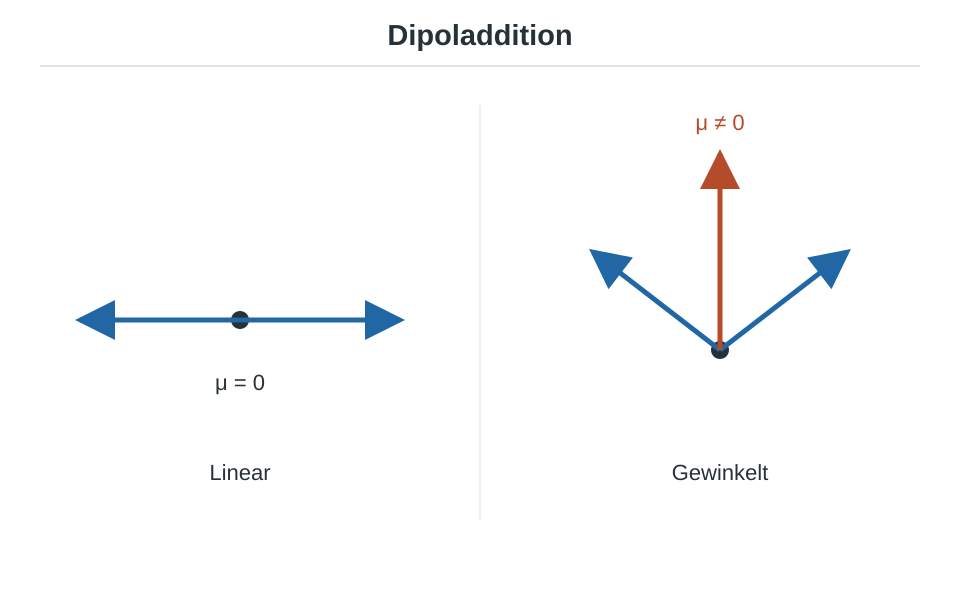

# M5-L4 – Molekülgeometrie und Polarität {#L4}

**Kursbereich:** M5 – Atomstruktur und chemische Bindung

**Niveau:** Bachelor

**Vorwissen:** [M5-L3](M5-L3.md).

**Lernziel:** Molekülgeometrien mit VSEPR vorhersagen und Bindungsdipole vektoriell zum Gesamtdipol verknüpfen.

## Elektronendomänen und Geometrie {#S1}
Das VSEPR-Modell ordnet Elektronendomänen um ein Zentralatom so an, dass ihre Abstoßung näherungsweise minimiert wird. Eine Mehrfachbindung zählt als eine Domäne. Zwei, drei und vier Domänen führen zu linearer, trigonal-planarer und tetraedrischer idealisierter Domänengeometrie. Freie Paare zählen als Domänen, aber nicht als Atome bei der Benennung der Molekülgestalt. Vier Domänen ergeben bei drei Bindungen und einem freien Paar eine trigonal-pyramidale, bei zwei Bindungen und zwei freien Paaren eine gewinkelte Gestalt.

*Pfeile zeigen schematisch Vektoren; die Resultierende liegt auf der Winkelhalbierenden.*

## Polarität als Vektorproblem {#S2}
Eine polare Bindung ist durch unsymmetrische Ladungsverteilung gekennzeichnet. Ein Moleküldipol ist die vektorielle Summe der Ladungsverteilung, näherungsweise durch Bindungsdipole und weitere Beiträge darstellbar. Symmetrie kann zur vollständigen Kompensation führen. Die VSEPR-Vorhersage ist ein qualitatives Strukturmodell, kein Verfahren zur Berechnung exakter Dipolmomente oder Bindungswinkel.
## Rechenbeispiel {#S3}
Im linearen CO₂ weisen die beiden gleich großen C–O-Bindungsdipole in entgegengesetzte Richtungen und kompensieren sich. In einem idealisierten gewinkelten Modell mit zwei gleichen Dipolbeträgen $\mu_b$ und Winkel $\theta$ ergibt sich der Betrag $2\mu_b\cos(\theta/2)$. Für $\theta=104{,}5^\circ$ und frei gewähltes $\mu_b=1{,}0$ D folgt 1,22 D. Dies illustriert Vektoraddition und ist keine Messwertvorhersage für Wasser.

## Grenzen und typische Fehler {#S4}

Polare Bindungen implizieren keinen Gesamtdipol. Freie Paare und Symmetrie berücksichtigen.

## Selbstkontrolle {#S5}

### Aufgaben

1. Welche Molekülgestalt besitzt NH₃ nach VSEPR?
2. Ist ein ideales tetraedrisches CH₄-Molekül permanent polar?
3. Welche Resultierende liefern zwei gleich große entgegengesetzte Dipole?

::: {.lc-solutions data-lc-section="S5"}
1. Trigonal-pyramidal.
2. Nein; seine Symmetrie erzwingt Kompensation.
3. Null.
:::

**Weiterlesen:** [M5-L5](M5-L5.md).

## Quellen (extern) {#S6}

### Nachweise

- [OpenStax – Chemistry 2e, 7.6 Molecular Structure and Polarity](https://openstax.org/books/chemistry-2e/pages/7-6-molecular-structure-and-polarity) · Geometrie und Polarität · Fachlicher Bezug zur Lektion: M5-L4 – Molekülgeometrie und Polarität · Zuletzt abgerufen: 2026-11-25
