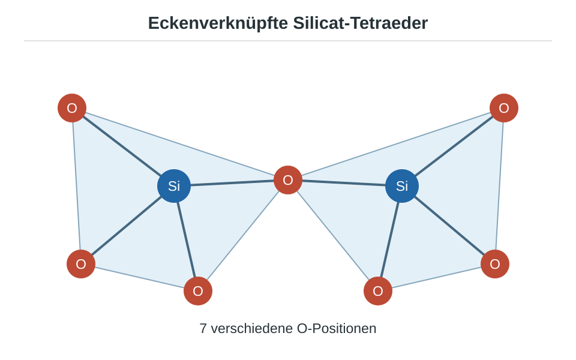

# M6-L3 – Hauptgruppenverbindungen {#L3}

**Kursbereich:** M6 – Anorganische Chemie der Hauptgruppen

**Niveau:** Bachelor

**Vorwissen:** [M6-L2](M6-L2.md).

**Lernziel:** Typische Stoffklassen der Hauptgruppen anhand von Bindung, Zusammensetzung und Struktur vergleichen.

## Stoffklassen und Strukturtypen {#S1}
Halogenide, Oxide, Hydride und Oxosalze lassen sich durch ihre Zusammensetzung gruppieren. Diese Namen legen keinen einheitlichen Bindungstyp fest: Natriumchlorid bildet ein Ionengitter, während molekulare Hauptgruppenhalogenide kovalente Bindungen aufweisen können. Wasserstoffverbindungen reichen von molekularem Wasser bis zu ionischen Hydriden und metallischen Einlagerungsverbindungen. Borverbindungen illustrieren Elektronenmangel; einfache Zweizentren-Zweielektronen-Bindungsbilder reichen nicht für alle Borcluster aus.

*Schematische Projektion: zwei SiO₄-Einheiten teilen eine O-Ecke.*

## Kohlenstoff, Silicium und Sauerstoff {#S2}
Kohlenstoff bildet stabile Ketten und Mehrfachbindungen; Silicium bildet mit Sauerstoff ausgedehnte Netzwerke aus verknüpften Tetraedern. CO₂ besteht unter gewöhnlichen Bedingungen aus diskreten linearen Molekülen; viele SiO₂-Modifikationen enthalten dagegen dreidimensional verknüpfte SiO₄-Einheiten. Die Formel SiO₂ gibt das Verhältnis an, nicht die Koordinationszahl. Bei Silicaten entstehen unterschiedliche Netzwerkdimensionen durch Verknüpfung über gemeinsame Sauerstoffatome.
## Zählbeispiel {#S3}
Zwei SiO₄-Tetraeder mit einer gemeinsamen Ecke enthalten zusammen sieben verschiedene O-Atome. Unter formaler Zuordnung Si(+IV) und O(−II) ergibt sich die Ladung 2·4 − 7·2 = −6. Bei einem vollständig eckenverknüpften idealen Netzwerk zählt jeder der vier Sauerstoffe pro Si nur zur Hälfte; daraus folgt SiO₂.

## Grenzen und typische Fehler {#S4}

Summenformeln liefern keine vollständige Strukturinformation.

## Selbstkontrolle {#S5}

### Aufgaben

1. Warum ist NaCl keine Aussage über ein isoliertes Molekül im Kristall?
2. Wie viele verschiedene O-Atome besitzen zwei SiO₄-Tetraeder mit einer gemeinsamen Ecke?
3. Welches O:Si-Verhältnis ergibt vollständige Eckenverknüpfung?

::: {.lc-solutions data-lc-section="S5"}
1. Die Formel gibt das Zahlenverhältnis der Gitterionen an.
2. 7.
3. 2:1.
:::

**Weiterlesen:** [M6-L4](M6-L4.md).

## Quellen (extern) {#S6}

### Nachweise

- [OpenStax – Chemistry 2e, 18.1 Periodicity](https://openstax.org/books/chemistry-2e/pages/18-1-periodicity) · Hauptgruppen und Periodizität · Fachlicher Bezug zur Lektion: M6-L3 – Hauptgruppenverbindungen · Zuletzt abgerufen: 2026-11-25
- [OpenStax – Chemistry 2e, 18.3 Structure and General Properties of the Metalloids](https://openstax.org/books/chemistry-2e/pages/18-3-structure-and-general-properties-of-the-metalloids) · Strukturen von Siliciumverbindungen · Fachlicher Bezug zur Lektion: M6-L3 – Hauptgruppenverbindungen · Zuletzt abgerufen: 2026-11-25
- [OpenStax – Chemistry 2e, 10.5 The Solid State of Matter](https://openstax.org/books/chemistry-2e/pages/10-5-the-solid-state-of-matter) · Festkörperklassen · Fachlicher Bezug zur Lektion: M6-L3 – Hauptgruppenverbindungen · Zuletzt abgerufen: 2026-11-25
