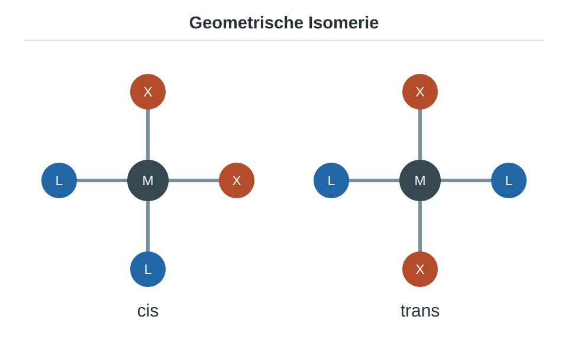

# M7-L1 – Koordinationszahlen und Liganden {#L1}

**Kursbereich:** M7 – Übergangsmetalle und Koordinationschemie

**Niveau:** Bachelor

**Vorwissen:** [M6-L5](M6-L5.md).

**Lernziel:** Koordinationszahl, Ligandenzähnigkeit, Oxidationszahl und geometrische Isomerie bestimmen.

## Aufbau von Koordinationsverbindungen {#S1}
Ein Zentralatom oder -ion bindet Liganden über Donoratome. Die Koordinationszahl zählt die direkt gebundenen Donoratome, nicht die Ligandenmoleküle. Monodentate Liganden binden über ein Atom, bidentate über zwei; bei Chelatliganden bildet die Anbindung einen oder mehrere Ringe. Die formale Oxidationszahl des Metalls folgt aus der Komplexladung und den formalen Ligandenladungen. Übergangsmetalle besitzen als Atom oder in mindestens einem Kation eine unvollständig besetzte d-Unterschale; nicht jedes d-Block-Element erfüllt diese Definition.

*Gleiche Zusammensetzung ML₂X₂, unterschiedliche Anordnung.*

## Geometrie und Isomerie {#S2}
Vierfach koordinierte Zentren können tetraedrisch oder quadratisch-planar sein; sechsfach koordinierte Zentren sind häufig oktaedrisch. Bei einem quadratisch-planaren Komplex ML₂X₂ liegen die gleichartigen Liganden in der cis-Form benachbart, in der trans-Form gegenüber. Auch oktaedrische Komplexe zeigen geometrische und unter geeigneten Bedingungen optische Isomerie. Isomere besitzen dieselbe Zusammensetzung, aber verschiedene räumliche Anordnungen oder Bindungszuordnungen.
## Zählbeispiel {#S3}
Im Ion [Co(NH₃)₅Cl]²⁺ liefern fünf neutrale Amminliganden und ein Chloridoligand mit −1 insgesamt sechs Donoratome. Für Co gilt x − 1 = +2, also x = +3. Cobalt gehört zur Gruppe 9; im formalen Co(III)-Ion verbleiben sechs d-Elektronen (d⁶). Diese Zählung beschreibt eine formale Konfiguration und keine vollständige elektronische Wellenfunktion.

## Grenzen und typische Fehler {#S4}

Ligandenzahl und Koordinationszahl nicht verwechseln.

## Selbstkontrolle {#S5}

### Aufgaben

1. Welche Koordinationszahl besitzt ein Komplex mit drei bidentaten Liganden?
2. Welche Oxidationszahl hat Fe in [Fe(H₂O)₆]²⁺?
3. Welchen Winkel schließen gleichartige Liganden im idealen quadratisch-planaren trans-Isomer ein?

::: {.lc-solutions data-lc-section="S5"}
1. 6, sofern alle sechs Donoratome gebunden sind.
2. +2.
3. 180°.
:::

**Weiterlesen:** [M7-L2](M7-L2.md).

## Quellen (extern) {#S6}

### Nachweise

- [OpenStax – Chemistry 2e, 19.2 Coordination Chemistry of Transition Metals](https://openstax.org/books/chemistry-2e/pages/19-2-coordination-chemistry-of-transition-metals) · Komplexe, Geometrie und Isomerie · Fachlicher Bezug zur Lektion: M7-L1 – Koordinationszahlen und Liganden · Zuletzt abgerufen: 2026-11-25
- [OpenStax – Chemistry 2e, 19.1 Occurrence, Preparation, and Properties of Transition Metals and Their Compounds](https://openstax.org/books/chemistry-2e/pages/19-1-occurrence-preparation-and-properties-of-transition-metals-and-their-compounds) · Übergangsmetalle und Oxidationsstufen · Fachlicher Bezug zur Lektion: M7-L1 – Koordinationszahlen und Liganden · Zuletzt abgerufen: 2026-11-25
