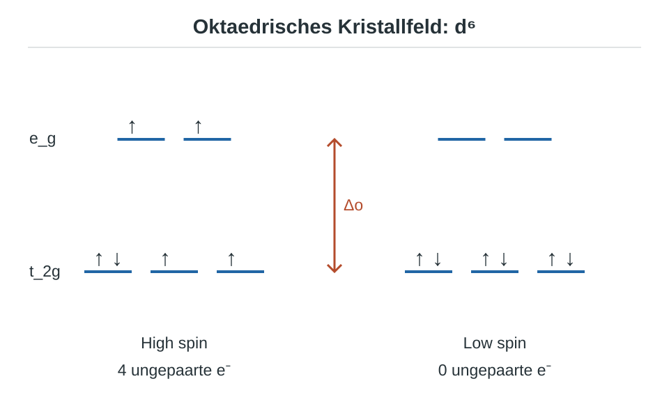

# M7-L2 – Kristallfeld- und Ligandenfeldmodelle {#L2}

**Kursbereich:** M7 – Übergangsmetalle und Koordinationschemie

**Niveau:** Bachelor

**Vorwissen:** [M7-L1](M7-L1.md).

**Lernziel:** Die oktaedrische d-Orbitalaufspaltung und ihre Folgen für Spin und Stabilisierung erklären.

## Kristallfeld und Ligandenfeld {#S1}
Im idealen oktaedrischen Kristallfeld weisen die Liganden entlang der Koordinatenachsen auf das Metallzentrum. Die d-Orbitale d(x²−y²) und d(z²) erfahren im elektrostatischen Modell stärkere Abstoßung als d(xy), d(xz) und d(yz). Es entstehen zwei e_g- und drei t_2g-Orbitale, getrennt um $\Delta_o$. Relativ zum Schwerpunkt liegen sie bei +0,6 bzw. −0,4 $\Delta_o$. Im Ligandenfeldmodell kommen kovalente Metall-Ligand-Wechselwirkungen hinzu; insbesondere σ- und π-Wechselwirkungen beeinflussen die Aufspaltung.

*Idealisiertes Besetzungsschema, gleiche Aufspaltung zur Veranschaulichung; Paarungsenergie nicht dargestellt.*

## Elektronenbesetzung {#S2}
Die Elektronen verteilen sich unter Beachtung des Pauli-Prinzips und der Hund-Regel. Bei oktaedrischen d⁴- bis d⁷-Konfigurationen können unterschiedliche Spinbesetzungen entstehen. Große Aufspaltung gegenüber Paarungsenergie begünstigt niedrigen Spin; kleine Aufspaltung hohen Spin. Tetraedrische Aufspaltung besitzt eine andere Reihenfolge und ist im einfachen Modell für vergleichbare Liganden kleiner. Die Geometrie beeinflusst also die Besetzung wesentlich.
## Rechenbeispiel für d⁶ {#S3}
High-spin d⁶ besitzt t_2g⁴ e_g² und vier ungepaarte Elektronen. Die reine Kristallfeldstabilisierungsenergie beträgt $4(-0{,}4\Delta_o)+2(0{,}6\Delta_o)=-0{,}4\Delta_o$. Low-spin d⁶ besitzt t_2g⁶ e_g⁰, keine ungepaarten Elektronen und $-2{,}4\Delta_o$. Beim energetischen Vergleich sind zusätzlich die unterschiedlichen Paarungsenergien zu berücksichtigen.

## Grenzen und typische Fehler {#S4}

Kristallfeldenergien sind relativ zum Schwerpunkt; Paarung und Kovalenz beachten.

## Selbstkontrolle {#S5}

### Aufgaben

1. Wie viele Orbitale umfasst t_2g?
2. Wie groß ist die reine Kristallfeldstabilisierung bei oktaedrischem d³?
3. Wie viele ungepaarte Elektronen hat oktaedrisches low-spin d⁶?

::: {.lc-solutions data-lc-section="S5"}
1. Drei.
2. −1,2 Δ_o.
3. Null.
:::

**Weiterlesen:** [M7-L3](M7-L3.md).

## Quellen (extern) {#S6}

### Nachweise

- [OpenStax – Chemistry 2e, 19.3 Spectroscopic and Magnetic Properties of Coordination Compounds](https://openstax.org/books/chemistry-2e/pages/19-3-spectroscopic-and-magnetic-properties-of-coordination-compounds) · Kristallfeld, Spin und Spektren · Fachlicher Bezug zur Lektion: M7-L2 – Kristallfeld- und Ligandenfeldmodelle · Zuletzt abgerufen: 2026-11-25
