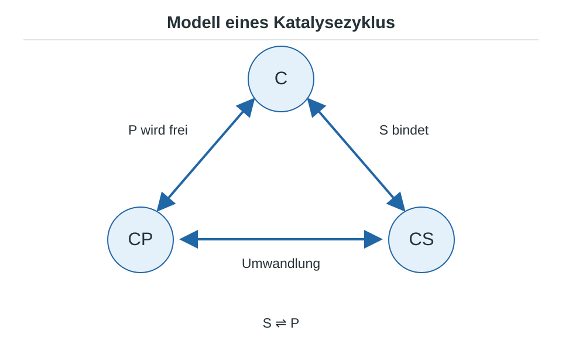

# M7-L5 – Einfache Katalysezyklen {#L5}

**Kursbereich:** M7 – Übergangsmetalle und Koordinationschemie

**Niveau:** Bachelor

**Vorwissen:** [M7-L4](M7-L4.md).

**Lernziel:** Einen einfachen katalytischen Zyklus bilanzieren und Aktivität, Selektivität sowie Regeneration unterscheiden.

## Katalytische Zwischenzustände {#S1}
Ein Katalysator eröffnet einen alternativen Reaktionsweg und wird im idealen Zyklus regeneriert. Bei Metallkomplexen können Substrate an freie Koordinationsstellen binden, innerhalb der Koordinationssphäre umgewandelt und als Produkte freigesetzt werden. Elementarschritte können Ligandenassoziation, Dissoziation, Elektronentransfer oder Bindungsumlagerung umfassen. In realen Systemen konkurrieren Nebenreaktionen, reversible Bindung und Deaktivierung. Eine gezeichnete Zyklusfolge ist zunächst eine Hypothese, die durch Kinetik, Spektroskopie und Stoffbilanzen geprüft werden muss.

*Gesamtreaktion S ⇌ P. C, CS und CP kürzen sich in der Bilanz.*

## Bilanz eines Modellzyklus {#S2}
Ein abstrahiertes Metallzentrum C bindet das Substrat S: C + S ⇌ CS. Die gebundene Form geht in CP über: CS ⇌ CP. Anschließend wird das Produkt freigesetzt: CP ⇌ C + P. Addition der drei Nettoschritte ergibt S ⇌ P; C, CS und CP kürzen sich heraus. Die Gesamtgleichgewichtskonstante bleibt durch den alternativen Weg unverändert. Die individuellen Zwischenzustände und Aktivierungsbarrieren bestimmen jedoch die beobachtete Rate.
## Rechenbeispiel {#S3}
Die Turnover Number (TON) ist hier die Stoffmenge gebildeten Produkts geteilt durch die anfänglich eingesetzte Stoffmenge aktiver Zentren. Bei 2 µmol Zentren und 100 µmol Produkt ergibt sich TON = 50. Entsteht diese Menge innerhalb von 100 s, beträgt die über dieses Intervall gemittelte Turnover Frequency (TOF) 0,50 s⁻¹, bezogen auf die anfängliche Zentrenzahl. Unbekannte aktive Zentrenzahl und Deaktivierung begrenzen den Vergleich. Die Werte sind frei gewählte Modelldaten.

## Grenzen und typische Fehler {#S4}

TON und TOF mit Bezugsgröße und Zeitintervall angeben; Terminologie variiert historisch.

## Selbstkontrolle {#S5}

### Aufgaben

1. Welche Nettoreaktion ergibt der Modellzyklus?
2. Ändert ein Katalysator die thermodynamische Gleichgewichtskonstante?
3. TON bei 5 µmol Zentren und 200 µmol Produkt?

::: {.lc-solutions data-lc-section="S5"}
1. S ⇌ P.
2. Nein, bei unveränderten Bedingungen.
3. 40.
:::

## Quellen (extern) {#S6}

### Nachweise

- [OpenStax – Chemistry 2e, 12.7 Catalysis](https://openstax.org/books/chemistry-2e/pages/12-7-catalysis) · Katalytische Reaktionswege · Fachlicher Bezug zur Lektion: M7-L5 – Einfache Katalysezyklen · Zuletzt abgerufen: 2026-11-25
- [OpenStax – Chemistry 2e, 19.2 Coordination Chemistry of Transition Metals](https://openstax.org/books/chemistry-2e/pages/19-2-coordination-chemistry-of-transition-metals) · Komplexe, Geometrie und Isomerie · Fachlicher Bezug zur Lektion: M7-L5 – Einfache Katalysezyklen · Zuletzt abgerufen: 2026-11-25
- [IUPAC Gold Book – turnover frequency (T06534)](https://goldbook.iupac.org/terms/view/T06534) · Terminologie; ältere abweichende TON-Verwendung beachten · Fachlicher Bezug zur Lektion: M7-L5 – Einfache Katalysezyklen · Zuletzt abgerufen: 2026-11-25
