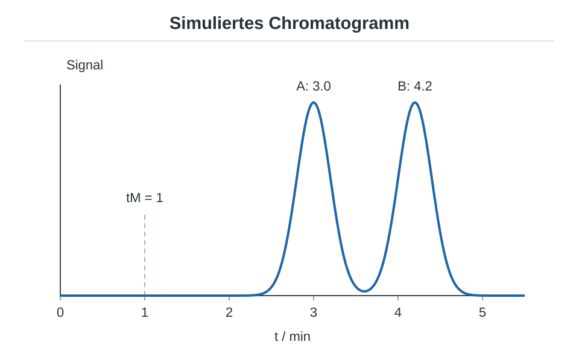

# M8-L4 – Chromatografische Grundprinzipien {#L4}

**Kursbereich:** M8 – Analytische Chemie I: Trennung und Nachweis

**Niveau:** Bachelor

**Vorwissen:** [M8-L3](M8-L3.md).

**Lernziel:** Retention, Selektivität und Auflösung chromatografischer Trennungen quantitativ einordnen.

## Stationäre und mobile Phase {#S1}
Chromatografie trennt Komponenten aufgrund unterschiedlicher Wechselwirkungen mit einer stationären und einer mobilen Phase. Komponenten, die sich im Mittel länger in der stationären Phase aufhalten, erreichen bei sonst gleichen Bedingungen später den Detektor. In der Gaschromatografie ist die mobile Phase gasförmig, in der Flüssigchromatografie flüssig. Je nach Trennmechanismus wirken Verteilung, Adsorption, Ionenaustausch oder Größenausschluss. Retentionszeit ist eine methodenabhängige Größe, kein eindeutiger molekularer Fingerabdruck.

*Gauß-Peaks mit σ = 0,2 min; Basisbreite als 4σ definiert.*

## Quantitative Kenngrößen {#S2}
Für die Retentionszeit $t_R$ und die Totzeit $t_M$ eines nicht zurückgehaltenen Stoffes ist der Retentionsfaktor $k=(t_R-t_M)/t_M$. Für zwei Peaks mit $k_2>k_1>0$ ist die Selektivität $\alpha=k_2/k_1$. Die Auflösung unter Verwendung der Basisbreiten $w_1,w_2$ ist $R_s=2(t_{R,2}-t_{R,1})/(w_1+w_2)$. Die Breiten müssen nach derselben Definition ermittelt werden. Bei symmetrischen vergleichbar hohen Peaks gilt etwa 1,5 als häufig verwendete Orientierung für Basislinientrennung, nicht als universale Garantie.
## Modellchromatogramm {#S3}
Totzeit 1,0 min; Peak A bei 3,0 min, B bei 4,2 min; beide Basisbreiten 0,8 min. Daraus folgen $k_A=2{,}0$, $k_B=3{,}2$, $\alpha=1{,}6$ und $R_s=1{,}5$. Peakflächen können zur Mengenbestimmung dienen, wenn die Detektorantwort kalibriert und Interferenzen ausreichend getrennt sind. Das gezeigte Chromatogramm ist simuliert.

## Grenzen und typische Fehler {#S4}

Retentionszeit ist methodenabhängig; Breitenkonvention angeben.

## Selbstkontrolle {#S5}

### Aufgaben

1. Was bedeutet k=0?
2. Zwei Peaks liegen 0,6 min auseinander, beide sind an der Basis 0,6 min breit. Auflösung?
3. Beweist gleiche Retentionszeit gleiche Identität?

::: {.lc-solutions data-lc-section="S5"}
1. Keine Retention gegenüber dem nicht zurückgehaltenen Marker.
2. 1,0.
3. Nein; Koelution und methodenabhängige Retention sind möglich.
:::

**Weiterlesen:** [M8-L5](M8-L5.md).

## Quellen (extern) {#S6}

### Nachweise

- [Harvey – Analytical Chemistry Vol. II, chapter 3](https://chem.libretexts.org/Bookshelves/Analytical_Chemistry/Analytical_Chemistry_2.1_by_David_Harvey/Analytical_Chemistry_Volume_II_%28Harvey%29/03%3A_Chromatographic_and_Electrophoretic_Methods) · Chromatografische Trennung · Fachlicher Bezug zur Lektion: M8-L4 – Chromatografische Grundprinzipien · Zuletzt abgerufen: 2026-11-25
- [Harvey – Analytical Chemistry 2.1, 12.3 Optimizing Chromatographic Separations](https://chem.libretexts.org/Bookshelves/Analytical_Chemistry/Analytical_Chemistry_2.1_by_David_Harvey/Analytical_Chemistry_2.1_%28Harvey%29/12%3A_Chromatographic_and_Electrophoretic_Methods/12.03%3A_Optimizing_Chromatographic_Separations) · Retention und Auflösung · Fachlicher Bezug zur Lektion: M8-L4 – Chromatografische Grundprinzipien · Zuletzt abgerufen: 2026-11-25
