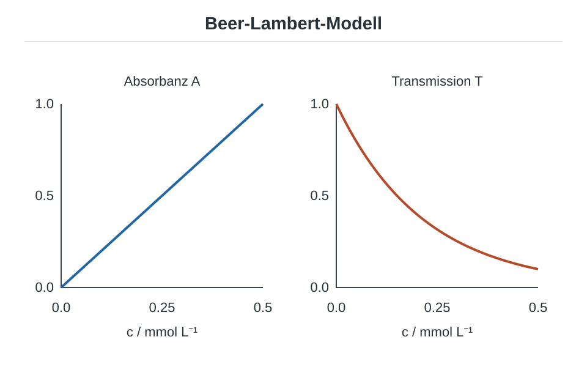

# M9-L1 – UV/Vis und IR als Messmethoden {#L1}

**Kursbereich:** M9 – Analytische Chemie II: Instrumentelle Methoden

**Niveau:** Bachelor

**Vorwissen:** [M8-L5](M8-L5.md).

**Lernziel:** UV/Vis- und IR-Spektroskopie nach Übergängen, Signalen und Anwendungsgrenzen unterscheiden.

## Lichtabsorption und UV/Vis {#S1}
In der UV/Vis-Spektroskopie können Photonen elektronische Übergänge auslösen. Aus einfallender und transmittierter Intensität folgt die dimensionslose Absorbanz $A=-\log_{10}(I/I_0)$. Im idealisierten Beer-Lambert-Modell gilt $A=\varepsilon lc$, mit molarem dekadischem Absorptionskoeffizienten ε, Schichtdicke l und Stoffmengenkonzentration c. Bei l in cm und c in mol/L hat ε die Einheit L mol⁻¹ cm⁻¹. Die Beziehung setzt unter anderem geeignete spektrale Bandbreite, vernachlässigbare Streuung und eine konstante absorbierende Spezies voraus.

*Ideales Modell mit ε = 2000 L mol⁻¹ cm⁻¹ und l = 1 cm; getrennte Skalen.*

## Infrarotspektroskopie {#S2}
IR-Absorption erfasst Schwingungsübergänge, wenn sich das elektrische Dipolmoment entlang der Schwingungskoordinate ändert. Die Wellenzahl $\tilde\nu=1/\lambda$ wird häufig in cm⁻¹ angegeben. Frequenzbereiche geben Hinweise auf Bindungen und funktionelle Gruppen; Überlagerung, Kopplung und molekulare Umgebung verschieben oder verändern Banden. FTIR erfasst ein Interferogramm, aus dem durch Fourier-Transformation ein Spektrum gewonnen wird. UV/Vis und IR liefern komplementäre Information.
## Modellrechnung {#S3}
Für eine simulierte UV/Vis-Messung sei ε = 2000 L mol⁻¹ cm⁻¹, l = 1,00 cm und c = 0,000250 mol/L. Dann beträgt A = 0,500 und die Transmission $10^{-0{,}500}=0{,}316$, also 31,6 %. Eine Absorbanzverdopplung bedeutet nicht halbierte Transmission. Bei IR entspricht 1700 cm⁻¹ einer Wellenlänge von ungefähr 5,88 µm.

## Grenzen und typische Fehler {#S4}

Beer-Lambert nur im geeigneten Arbeitsbereich; Spektren nicht überinterpretieren.

## Selbstkontrolle {#S5}

### Aufgaben

1. Was passiert mit A bei doppelter Konzentration im idealen Modell?
2. Welche Änderung ist für eine IR-aktive Normalschwingung erforderlich?
3. A=1: Wie groß ist die Transmission?

::: {.lc-solutions data-lc-section="S5"}
1. A verdoppelt sich.
2. Eine Änderung des Dipolmoments entlang der Schwingungskoordinate.
3. 10 %.
:::

**Weiterlesen:** [M9-L2](M9-L2.md).

## Quellen (extern) {#S6}

### Nachweise

- [Harvey – Analytical Chemistry 2.1, 10.11 Spectroscopic Methods summary](https://chem.libretexts.org/Bookshelves/Analytical_Chemistry/Analytical_Chemistry_2.1_by_David_Harvey/Analytical_Chemistry_2.1_%28Harvey%29/10%3A_Spectroscopic_Methods/10.11%3A_Chapter_Summary_and_Key_Terms) · Absorption, Wellenzahl, FTIR-Begriffe · Fachlicher Bezug zur Lektion: M9-L1 – UV/Vis und IR als Messmethoden · Zuletzt abgerufen: 2026-11-25
- [Harvey – Analytical Chemistry Vol. II, chapter 1](https://chem.libretexts.org/Bookshelves/Analytical_Chemistry/Analytical_Chemistry_2.1_by_David_Harvey/Analytical_Chemistry_Volume_II_%28Harvey%29) · Spektroskopische und instrumentelle Methoden · Fachlicher Bezug zur Lektion: M9-L1 – UV/Vis und IR als Messmethoden · Zuletzt abgerufen: 2026-11-25
