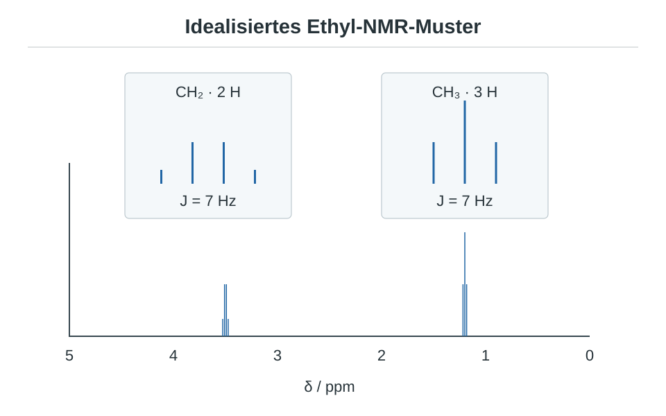

# M9-L3 – NMR-Grundlagen {#L3}

**Kursbereich:** M9 – Analytische Chemie II: Instrumentelle Methoden

**Niveau:** Bachelor

**Vorwissen:** [M9-L2](M9-L2.md).

**Lernziel:** Chemische Verschiebung, Integration und einfache Spin-Spin-Kopplung in Protonen-NMR-Spektren erklären.

## Magnetische Resonanz {#S1}
Kerne mit nichtverschwindendem Kernspin können in einem Magnetfeld unterschiedliche Energieniveaus einnehmen. Ein Radiofrequenzfeld kann Übergänge anregen; das zeitabhängige Signal nach Anregung lässt sich in ein Frequenzspektrum transformieren. Die elektronische Umgebung beeinflusst die Abschirmung. Chemische Verschiebungen werden als $\delta=(\nu-\nu_{ref})/\nu_0\cdot10^6$ in ppm angegeben, wobei ν₀ die Bezugsfrequenz des beobachteten Kerns bezeichnet. Die Referenz und Messbedingungen sind anzugeben.

*Simulierte ¹H-Linien mit J = 7 Hz bei 400 MHz; Flächenverhältnis 2:3; Vergrößerungen zeigen die Aufspaltung.*

## Integration und Kopplung {#S2}
Unter geeigneten quantitativen Messbedingungen sind integrierte Protonensignale proportional zur Zahl beitragender Protonen. Benachbarte magnetisch nichtäquivalente Kerne können ein Signal durch skalare Kopplung aufspalten. Bei einfachen Spektren erster Ordnung ergibt ein Satz von n gleichartig gekoppelten äquivalenten Nachbarprotonen ein Multiplett mit n+1 Linien. Austauschbare Protonen, Überlagerung und starke Kopplung können davon abweichen. Entkoppelte ¹³C-Spektren zeigen häufig einzelne Resonanzen je unterscheidbarer Kohlenstoffumgebung; deren Intensitäten sind üblicherweise nicht ohne Weiteres quantitativ.
## Modellbeispiel {#S3}
Eine idealisierte Ethylgruppe zeigt ein Triplett mit Integral 3 und ein Quartett mit Integral 2. Beide besitzen dieselbe Kopplungskonstante J = 7 Hz. Das CH₃-Signal wird durch zwei CH₂-Protonen gespalten, das CH₂-Signal durch drei CH₃-Protonen. Bei 400 MHz entspricht eine Verschiebungsdifferenz von 1 ppm einer Frequenzdifferenz von 400 Hz. Das simulierte Muster belegt eine plausible Ethylgruppe, aber keine eindeutige Gesamtstruktur.

## Grenzen und typische Fehler {#S4}

n+1-Regel nur unter passenden Kopplungsbedingungen.

## Selbstkontrolle {#S5}

### Aufgaben

1. Wofür steht das Integral eines geeigneten Protonensignals?
2. Drei äquivalente Nachbarprotonen im Modell erster Ordnung ergeben?
3. Welche Frequenzdifferenz entspricht 2 ppm bei 500 MHz?

::: {.lc-solutions data-lc-section="S5"}
1. Relativer Anteil der beitragenden Protonen.
2. Ein Quartett.
3. 1000 Hz.
:::

**Weiterlesen:** [M9-L4](M9-L4.md).

## Quellen (extern) {#S6}

### Nachweise

- [OpenStax – Organic Chemistry, 13.2 The Nature of NMR Absorptions](https://openstax.org/books/organic-chemistry/pages/13-2-the-nature-of-nmr-absorptions) · NMR-Signale und Abschirmung · Fachlicher Bezug zur Lektion: M9-L3 – NMR-Grundlagen · Zuletzt abgerufen: 2026-11-25
- [OpenStax – Organic Chemistry, 13.6 Spin–Spin Splitting](https://openstax.org/books/organic-chemistry/pages/13-6-spin-spin-splitting-in-1h-nmr-spectra) · Kopplung und Multipletts · Fachlicher Bezug zur Lektion: M9-L3 – NMR-Grundlagen · Zuletzt abgerufen: 2026-11-25
