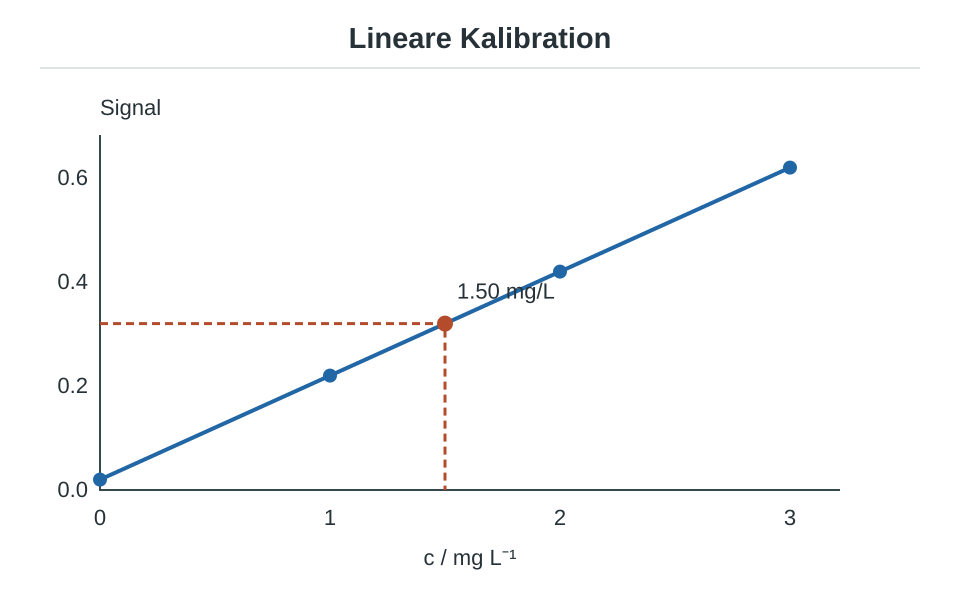

# M9-L5 – Kalibration und Validierung {#L5}

**Kursbereich:** M9 – Analytische Chemie II: Instrumentelle Methoden

**Niveau:** Bachelor

**Vorwissen:** [M9-L4](M9-L4.md).

**Lernziel:** Kalibrationsmodelle auswählen und wesentliche Leistungsmerkmale analytischer Methoden beurteilen.

## Kalibration und Auswertung {#S1}
Bei einer externen Kalibration werden bekannte Analytgehalte mit Messsignalen verknüpft. Ein lineares Modell $y=a+bc$ enthält Achsenabschnitt a und Empfindlichkeit b. Unbekannte Gehalte werden über $c=(y-a)/b$ geschätzt. Die Eignung des Modells ist anhand der Residuen, des Arbeitsbereichs und der Unsicherheit zu prüfen; ein hoher Bestimmtheitswert allein reicht nicht. Interne Standards nutzen ein Signalverhältnis zur Verringerung geeigneter Variationen. Standardaddition kann bei linearem Verhalten und vergleichbaren Bedingungen Matrixeffekte berücksichtigen, setzt aber voraus, dass Zugabe und ursprünglicher Analyt vergleichbar reagieren.

*Simulierte Kalibration y = 0,02 + 0,20c; keine realen Messdaten.*

## Validierung und Verifizierung {#S2}
Validierung untersucht, ob die Methode für einen bestimmten Zweck geeignet ist. Dazu gehören Selektivität, Arbeitsbereich, Richtigkeit, Präzision, Robustheit, Nachweis- und Bestimmungsgrenze. Die Nachweisgrenze beschreibt die Nachweisfähigkeit unter festgelegten statistischen Bedingungen; die Bestimmungsgrenze berücksichtigt eine geforderte quantitative Leistungsfähigkeit. Eine Verifizierung bestätigt, dass bereits festgelegte Anforderungen unter den eigenen Einsatzbedingungen erfüllt werden. Akzeptanzkriterien und Untersuchungsdesign müssen zur Matrix und zur beabsichtigten Entscheidung passen.
## Modellrechnung und Residuen {#S3}
Für simulierte Standards 0, 1, 2, 3 mg/L ergeben sich Signale 0,02; 0,22; 0,42; 0,62. Damit ist $y=0{,}02+0{,}20c$. Ein Probensignal 0,32 ergibt 1,50 mg/L. Bei einer modellhaften Standardabweichung des Blindwertsignals von 0,010 entsprechen 3s/b und 10s/b den Konzentrationsschätzungen 0,15 bzw. 0,50 mg/L. Diese einfachen Faktoren sind nur heuristische Modellschätzungen, keine automatisch gültigen Nachweis- oder Bestimmungsgrenzen. Reale Grenzwerte verlangen ein definiertes statistisches Verfahren und experimentelle Prüfung.

## Grenzen und typische Fehler {#S4}

Grenzwertschätzungen benötigen experimentelle Bestätigung.

## Selbstkontrolle {#S5}

### Aufgaben

1. Warum Residuen prüfen?
2. y=0,10+0,25c; y=0,60. Konzentration?
3. Reicht ein hoher R²-Wert zur Validierung?

::: {.lc-solutions data-lc-section="S5"}
1. Sie können Nichtlinearität, Ausreißer und ungleiche Varianz sichtbar machen.
2. 2,0 in der Konzentrationseinheit des Modells.
3. Nein; weitere zweckbezogene Leistungsmerkmale sind zu prüfen.
:::

## Quellen (extern) {#S6}

### Nachweise

- [Harvey – Analytical Chemistry 2.1, 5.2 Calibrating the Signal](https://chem.libretexts.org/Bookshelves/Analytical_Chemistry/Analytical_Chemistry_2.1_by_David_Harvey/Analytical_Chemistry_2.1_%28Harvey%29/05%3A_Standardizing_Analytical_Methods/5.02%3A_Calibrating_the_Signal) · Kalibrationsmodelle · Fachlicher Bezug zur Lektion: M9-L5 – Kalibration und Validierung · Zuletzt abgerufen: 2026-11-25
- [Eurachem – Fitness for Purpose of Analytical Methods, 3rd ed. (2025)](https://www.eurachem.org/index.php/publications/guides/mv) · Methodenvalidierung und Probenahme; Leitlinien-Übersicht · Fachlicher Bezug zur Lektion: M9-L5 – Kalibration und Validierung · Zuletzt abgerufen: 2026-11-25
